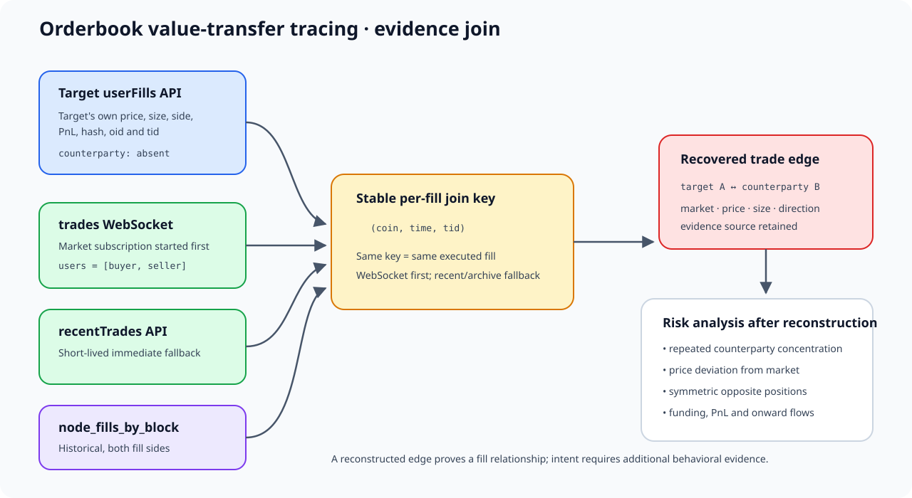

# 02. 오더북 가치 이전 추적

핵심은 `userFills` 한 자료만 보는 것이 아니라 동일 체결키 `(coin, time, tid)`를 사용해 공개 체결 자료와 결합하는 것입니다.

검증된 메인넷 공개 결과 예시는 [`examples/mainnet_counterparty_verified.json`](examples/mainnet_counterparty_verified.json)에 있습니다.



```text
의심 주소 userFills ── (coin,time,tid) ── trades WebSocket
       │                                  │ users=[양쪽 주소]
       └─ 가격·수량·방향·PnL              └─ 체결 상대방
                         │
                         └─ 사건 그래프: 누가 누구에게 어떤 시장에서 가치 이전
```

## 코드 읽기 가이드

### `mainnet_live_trace.py` — 메인넷 실시간 공개 추적

| 코드 부분 | 쉬운 설명 |
|---|---|
| `resolve_markets()` | 사람이 입력한 `HYPE/USDC`를 API 식별자 `@107` 같은 값으로 바꿉니다. |
| `user_fills()` | 의심 주소 본인의 체결 내역을 가져옵니다. 상대방 주소는 보통 없습니다. |
| `MultiMarketTradeStream` | 선택한 시장의 모든 공개 체결을 실시간으로 NDJSON에 저장합니다. |
| `fill_key()` | 동일 체결을 찾기 위한 `(coin,time,tid)` 키를 만듭니다. |
| `counterparty_from_trade()` | `users=[buyer,seller]`에서 의심 주소가 아닌 다른 주소를 꺼냅니다. |
| `main()` | 거래 전 자료 → 실시간 수집 → 거래 후 자료 → 상대방 결합 순서로 실행합니다. |

수집기는 반드시 거래보다 먼저 실행해야 합니다. `READY` 이후의 WebSocket 체결만 로컬 증거로 보존됩니다.

### `testnet_controlled_trade.py` — 테스트넷 통제 거래 진입점

이 파일은 명령어를 쉽게 만들기 위한 짧은 진입점입니다. 실제 안전 검증과 주문은 [`실행도구/테스트넷_T1_단건체결.py`](실행도구/테스트넷_T1_단건체결.py)가 담당합니다.

```text
환경 검증 → WebSocket 시작 → maker 주문 → 호가 재확인
→ IOC taker 주문 → 양쪽 userFills·공개 trades 비교 → 비밀키 검사 후 저장
```

### `node_archive_join.py` — 실시간을 놓친 과거 체결 복원

| 코드 부분 | 쉬운 설명 |
|---|---|
| `read_jsonl()` | 큰 시간별 노드 파일을 한 줄씩 읽어 메모리 사용을 줄입니다. |
| `current_events()` | `[지갑 주소, fill]` 형식을 공통 구조로 변환합니다. |
| `fill_key()` | 실시간 코드와 같은 `(coin,time,tid)` 키를 만듭니다. |
| 그룹화 단계 | 같은 키를 가진 매수·매도 양쪽 행을 묶습니다. |
| 결과 단계 | 의심 주소가 포함된 체결의 반대편 주소와 원본 행 위치를 저장합니다. |

즉, 실시간 WebSocket은 사고 당시 증거 보존용이고, 노드 아카이브는 이미 시간이 지난 사건의 복원용입니다.

### Testnet 보조 코드의 역할

| 파일 | 담당 기능 |
|---|---|
| [`테스트넷_사전점검.py`](실행도구/테스트넷_사전점검.py) | 네트워크, Master-Agent 연결, Agent 키, 주문 한도와 현재 잔고를 검증합니다. |
| [`체결도구.py`](실행도구/체결도구.py) | HYPE/USDC 계획 계산, WebSocket 수집, 주문 상태 확인, 실패 시 취소와 결과 검증을 담당합니다. |
| [`현물시장도구.py`](실행도구/현물시장도구.py) | 허용된 Testnet 현물 시장의 메타데이터·호가·잔고를 처리합니다. |
| [`테스트넷_T1_단건체결.py`](실행도구/테스트넷_T1_단건체결.py) | 양쪽 주소가 명확한 단건 체결을 생성하고 네 자료원에서 재구성합니다. |
| [`테스트넷_T2_T3_분할체결.py`](실행도구/테스트넷_T2_T3_분할체결.py) | 한 주문이 여러 상대방에게 나뉘는 체결을 검증합니다. |
| [`체결정보_보존성_재조회.py`](실행도구/체결정보_보존성_재조회.py) | 시간이 지난 뒤 `recentTrades`와 양쪽 `userFills`에 무엇이 남는지 재조회합니다. |

모든 실행 파일에는 기능 경계별 주석이 있으며, 서명 코드와 공개 조회 코드를 명확히 구분했습니다.

## A. 메인넷 실제 추적 — 읽기 전용

개인키가 필요 없고 주문하지 않습니다. 수집기를 먼저 시작한 뒤 브라우저에서 정상 소액 거래를 수동 실행합니다.

```bash
STAMP="$(date +%Y%m%d_%H%M%S)"
OUT="$PWD/결과/mainnet_orderbook_$STAMP"

python 02_오더북_가치이전/mainnet_live_trace.py \
  --user 0xTARGET_MASTER_ADDRESS \
  --market HYPE/USDC \
  --output-dir "$OUT" \
  --crosscheck-counterparties

python -m json.tool "$OUT/06_summary.json"
```

여러 주소·시장은 옵션을 반복합니다.

```bash
python 02_오더북_가치이전/mainnet_live_trace.py \
  --user 0xADDRESS_1 --user 0xADDRESS_2 \
  --market HYPE/USDC --market BTC \
  --duration-seconds 600 \
  --output-dir "결과/multi_market_$(date +%Y%m%d_%H%M%S)"
```

한 WebSocket 연결에서 시장별 `trades` 구독을 추가합니다. 시장 수의 실무 한계는 서버 구독 제한뿐 아니라 저장량·재연결·누락 감시 능력으로 결정해야 합니다.

`--crosscheck-counterparties`는 복원된 상대방의 공개 `userFills`도 호출하므로 짧은 검증 실험에만 권장합니다. 대량 감시에서는 API rate limit을 피하기 위해 끄고, 저장된 체결키를 노드 아카이브와 일괄 대조하십시오.

결과 파일:

- `00_manifest.json`: 대상 주소·시장·시작 시각
- `01/04_*accounts.json`: 전후 `userFills`
- `02/05_*markets.json`: 전후 `recentTrades`, `l2Book`
- `03_ws_trades.ndjson`: 실시간 공개 체결 원문
- `06_summary.json`: 새 체결, 상대방, 교차검증 결과

## B. 테스트넷 통제 거래 + 추적

`.env.local`에 Testnet Master 공개 주소 4개와 승인된 Agent 키를 입력합니다. 개인키 파일은 Git에서 제외됩니다.

```bash
cp .env.example .env.local
chmod 600 .env.local
python 02_오더북_가치이전/실행도구/테스트넷_사전점검.py --env .env.local

OUT="$PWD/결과/testnet_controlled_$(date +%Y%m%d_%H%M%S)"
python 02_오더북_가치이전/testnet_controlled_trade.py \
  --env .env.local \
  --output-dir "$OUT" \
  --execute-testnet-pilot
```

이 진입점은 기존의 안전장치가 적용된 `테스트넷_T1_단건체결.py`를 실행합니다.

- 공식 Testnet API만 허용
- Agent 개인키와 Agent 주소 일치 검증
- Master 공개 주소와 Agent 권한 검증
- 주문 금액·슬리피지 상한 검증
- maker가 의도대로 쉬지 않으면 taker 주문 거부
- 실패 시 잔존 주문 취소 시도
- 결과에 비밀키가 포함되지 않았는지 검사

## 세 데이터 소스의 역할

| 자료 | 역할 | 상대방 주소 | 보존상 주의 |
|---|---|---:|---|
| `userFills` | 의심 주소 자신의 체결·PnL을 확정 | 보통 없음 | 응답 건수/최근 기록 한계 |
| `trades` WebSocket | 시장 전체 체결과 `users` 양쪽 주소 보존 | 있음 | 미리 구독하지 않으면 놓침 |
| `recentTrades` | 직후 보조 복원 | 있음 | 매우 짧은 최근 구간이라 장기 증거가 아님 |
| 노드 fill/trade 아카이브 | 대규모 사후 복원·검증 | 스키마에 따라 가능 | 별도 수집·저장·파싱 필요 |

## C. 실시간 수집을 놓친 과거 체결 — 노드 아카이브

공식 Mainnet S3의 현재 fill 경로는 `s3://hl-mainnet-node-data/node_fills_by_block`입니다. requester-pays이므로 AWS 계정과 전송 비용이 필요합니다. 대상 날짜·시간만 내려받으십시오.

```bash
sudo apt install -y awscli lz4 jq

# 먼저 실제 키 구조와 대상 시간을 확인
aws s3 ls s3://hl-mainnet-node-data/node_fills_by_block/hourly/ \
  --request-payer requester

# 예: 한 시간 파일. 날짜/시간은 조사 범위로 교체
aws s3 cp \
  s3://hl-mainnet-node-data/node_fills_by_block/hourly/20260918/9.lz4 \
  node_data/20260918_09.lz4 \
  --request-payer requester

unlz4 node_data/20260918_09.lz4 node_data/20260918_09.jsonl

python 02_오더북_가치이전/node_archive_join.py \
  --input node_data/20260918_09.jsonl \
  --user 0xTARGET_ADDRESS \
  --coin BTC \
  --start-time-ms 1789689600000 \
  --end-time-ms 1789693199999 \
  --output 결과/node_counterparties.json
```

현재 형식은 한 줄이 한 블록이고 `events` 안에 `[주소, fill]`이 양쪽 각각 기록됩니다. 도구는 동일 `(coin,time,tid)` 두 행을 묶어 상대방을 복원합니다. 과거 `node_trades`의 `side_info` 형식도 읽을 수 있지만, 현재 수집에는 `node_fills_by_block`을 사용하십시오.

## 판정 원칙

- `(coin,time,tid)`가 같고 양쪽 주소가 `users`에 있을 때 체결 상대방을 직접 연결합니다.
- `hash`, 가격, 수량, 반대 방향의 상대방 `userFills`는 추가 교차검증입니다.
- 상대방 연결은 한 체결을 증명할 뿐, 공모·자금세탁 의도를 자동 증명하지 않습니다.
- 가격 이탈, 반복 상대방 집중도, 대칭 포지션, 자금 출처와 후속 경로를 추가 분석해야 합니다.
- 매우 활발한 주소는 `userFills`/`userFillsByTime` 최근 건수 한계를 빠르게 넘으므로 실시간 보존과 노드 아카이브가 필요합니다.

## 공식 참고 자료

- [WebSocket subscriptions와 WsTrade 스키마](https://hyperliquid.gitbook.io/hyperliquid-docs/for-developers/api/websocket/subscriptions)
- [Info endpoint와 userFills 한도](https://hyperliquid.gitbook.io/hyperliquid-docs/for-developers/api/info-endpoint)
- [공식 historical/node data 경로](https://hyperliquid.gitbook.io/hyperliquid-docs/historical-data)
- [L1 node data schemas](https://hyperliquid.gitbook.io/hyperliquid-docs/for-developers/nodes/l1-data-schemas)
- [API·WebSocket rate limits](https://hyperliquid.gitbook.io/hyperliquid-docs/for-developers/api/rate-limits-and-user-limits)
