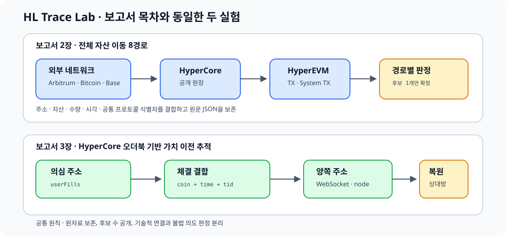

# HL Trace Lab

Hyperliquid의 공개 자료를 이용해 자산 이동을 재구성하는 연구 코드입니다. 보고서의 두 실험을 그대로 따라가도록 디렉터리를 구분했습니다.



## 보고서와 코드의 대응

| 보고서 | 코드 | 목적 |
|---|---|---|
| 2장. 자산 이동 경로와 공개 아티팩트 검증 | [`01_자산이동_8경로`](01_자산이동_8경로/README.md) | 8개 경로의 출발·도착 자료를 읽기 전용으로 조회하고 연결 |
| 3장. HyperCore 오더북 기반 가치 이전 추적 | [`02_오더북_가치이전`](02_오더북_가치이전/README.md) | `userFills`, 공개 체결 스트림, 노드 자료를 결합해 체결 상대방 복원 |
| 부록. 실행 코드와 재현 절차 | [`03_재현_가이드`](03_재현_가이드/실험_실행_가이드.md) | 설치, 실행 순서, 산출물과 판정 기준 |

## 폴더 구조

```text
01_자산이동_8경로/       보고서 2장: 경로 1~8 공개 추적기
02_오더북_가치이전/      보고서 3장: Testnet 재현·Mainnet 공개 추적
03_재현_가이드/          실행 절차와 보고서 목차 대응표
docs/diagrams/            보고서·README용 구조도
scripts/                  설치 도구
테스트/                   네트워크 없이 실행하는 단위 테스트
결과/                     로컬 산출물(Git 제외)
```

## 설치 — WSL 2 / Ubuntu 24.04

```bash
sudo apt update
sudo apt install -y git python3 python3-venv python3-pip

git clone https://github.com/junseng12/hl-trace-lab.git
cd hl-trace-lab
bash scripts/설치.sh
source .venv/bin/activate
```

## 실험 1 — 전체 자산 이동 8경로

8개 추적기는 공개 주소, 거래 해시, 시간 구간만 입력받습니다. 개인키와 서명은 필요하지 않습니다.

```bash
python 01_자산이동_8경로/route01_external_to_core.py --help
python 01_자산이동_8경로/route04_core_to_hyperevm.py --help
python 01_자산이동_8경로/route08_hyperevm_to_external.py --help
```

각 경로의 입력값, 결합 근거, 판정 기준은 [8경로 README](01_자산이동_8경로/README.md)에 정리되어 있습니다. 서로 다른 장부의 해시가 같다고 가정하지 않고 주소·자산·수량·시각·프로토콜 식별자를 결합하며, 후보가 하나일 때만 확정합니다.

## 실험 2 — 오더북 가치 이전 추적

메인넷에서는 수집기만 실행하고 브라우저에서 정상 소액 거래를 수동으로 수행합니다.

```bash
python 02_오더북_가치이전/mainnet_live_trace.py \
  --user 0xTARGET_MASTER_ADDRESS \
  --market HYPE/USDC \
  --output-dir "결과/mainnet_$(date +%Y%m%d_%H%M%S)"
```

Testnet 통제 실험만 승인된 Agent를 사용할 수 있습니다.

```bash
cp .env.example .env.local
chmod 600 .env.local
python 02_오더북_가치이전/실행도구/테스트넷_사전점검.py --env .env.local
python 02_오더북_가치이전/testnet_controlled_trade.py \
  --env .env.local \
  --output-dir "결과/testnet_$(date +%Y%m%d_%H%M%S)" \
  --execute-testnet-pilot
```

## 증거 판정 원칙

- 원본 응답과 조회 조건을 먼저 보존합니다.
- Core/EVM 교차 경로는 주소·자산·수량·시각·프로토콜 식별자를 함께 봅니다.
- 오더북 체결은 `(coin, time, tid)`를 기본 결합키로 사용합니다.
- 후보가 1개면 `UNIQUE_MATCH`, 0개 또는 복수면 확정하지 않습니다.
- 체결 상대방 복원은 기술적 연결을 뜻하며 공모나 불법 의도를 자동으로 증명하지 않습니다.

## 비밀값 관리

- `.env.local`, 개인키, 시드 문구, 로컬 결과 파일은 Git에 올리지 않습니다.
- 실제 비밀값이 채워진 파일은 저장소 밖에 보관합니다.
- Mainnet 자동 주문 코드는 제공하지 않습니다.
- 서명 기능은 Testnet에서 명시적으로 승인한 Agent와 설정된 안전 한도 안에서만 사용합니다.
